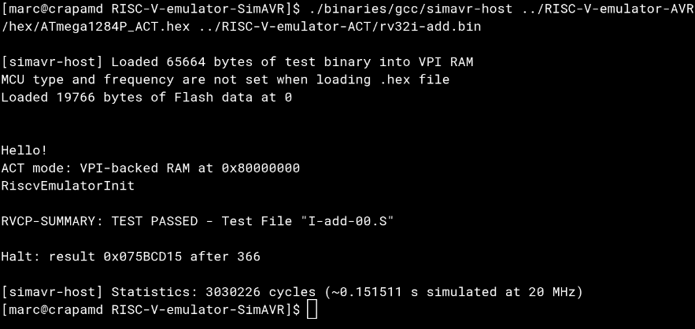

# RISC-V-emulator-SimAVR

simavr-host: a simavr wrapper that runs AVR firmware (Intel HEX) on an atmega1284p core and executes the RISC-V ACT tests via a VPI peripheral.

## How it works

- **[`src/main.c`](src/main.c)** — host wrapper. Loads the firmware, taps the UART0 TX IRQ (every transmitted byte goes to stdout) and runs the simulation. The VPI peripheral holds 64 MiB of host RAM at RISC-V address `0x80000000`. `-l <address>,<file>` loads an image at a physical address and is repeatable; `-b <file>` loads the DTB at `0x82200000`; `-D <file>` attaches a disk; `-N <ifname>` attaches a TAP interface; `-T <seconds>` sets a wall-clock timeout. Without `-T` the run has no timeout. `-S <prefix>` writes a snapshot on `SIGUSR1`; `-R <prefix>` loads a snapshot written by Native or SimAVR. `-C` forwards Ctrl-C to the guest as byte `0x03` instead of terminating the host on SIGINT; use it with MicroPython to raise `KeyboardInterrupt` and stop a guest that ignores the byte with `kill`. A positional `<test.bin>` loads at `0x80000000`. The simulation stops on power-down sleep, a BREAK halt loop (opcode 0x9598, detected via a repeating 2-instruction PC cycle), a VPI exit or the timeout. `-v` enables verbose output on stderr.
- **[`src/vpi.c`](src/vpi.c) / [`src/vpi.h`](src/vpi.h)** — VPI peripheral: backs the RISC-V RAM with host memory, carries the exit status and services synchronous host calls from the AVR firmware. The full register and call contract is in [`docs/vpi-host-calls.md`](docs/vpi-host-calls.md). The address is 32-bit; the firmware computes offset = address − 0x80000000.

## Usage

```
pio run -e simavr-host && .pio/build/simavr-host/simavr-host [-v] [-l <address>,<file>] [-b <file>] [-D <disk>] [-N <ifname>] [-S <prefix>] [-R <prefix>] [-T <seconds>] [-C] <firmware.hex> [<test.bin>]
```

`firmware.hex` is the AVR firmware (Intel HEX) that runs on the simulated atmega1284p and drives the RISC-V emulator. `test.bin` is the optional RISC-V test binary loaded at `0x80000000`; its exit code is the test result. For a Linux boot, load OpenSBI and U-Boot with `-l` and pass the DTB with `-b`.

With `-S <prefix>`, send `SIGUSR1` to the host process. The AVR firmware packs its CPU and device state into the last 4 KiB of guest RAM, which the DTB already reserves, and notifies the host. The host writes `<prefix>.json` and `<prefix>.bin` and the run continues. With `-R <prefix>`, the host loads the RAM image, places the state blob in that reserved area and asks the firmware to restore it before the next instruction. The JSON schema is shared with Native through [`RiscvEmulatorSnapshot.h`](../RISC-V-emulator/include/RiscvEmulatorSnapshot.h).

[](https://opensource.org/licenses/Apache-2.0)
